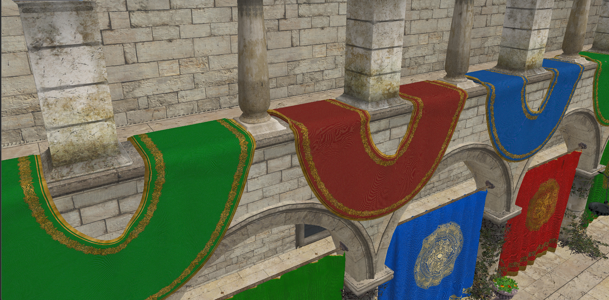
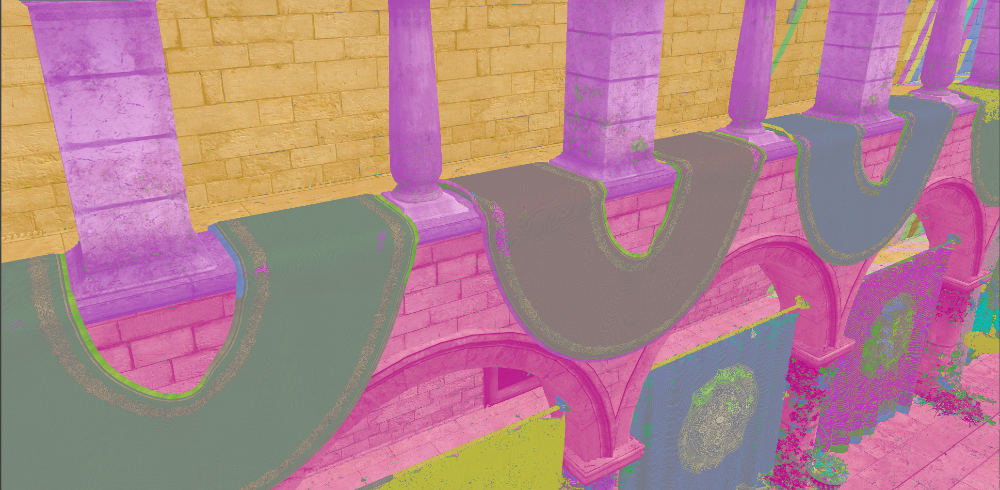
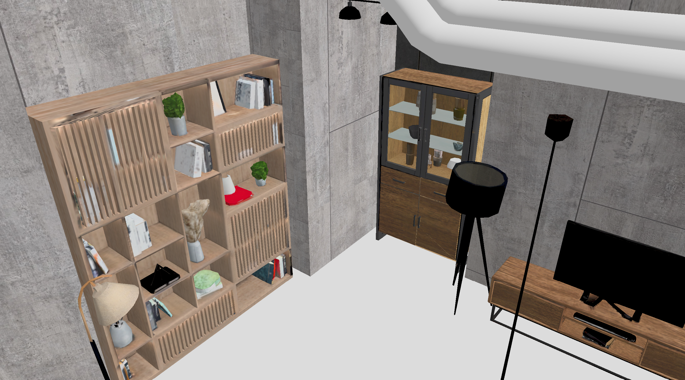
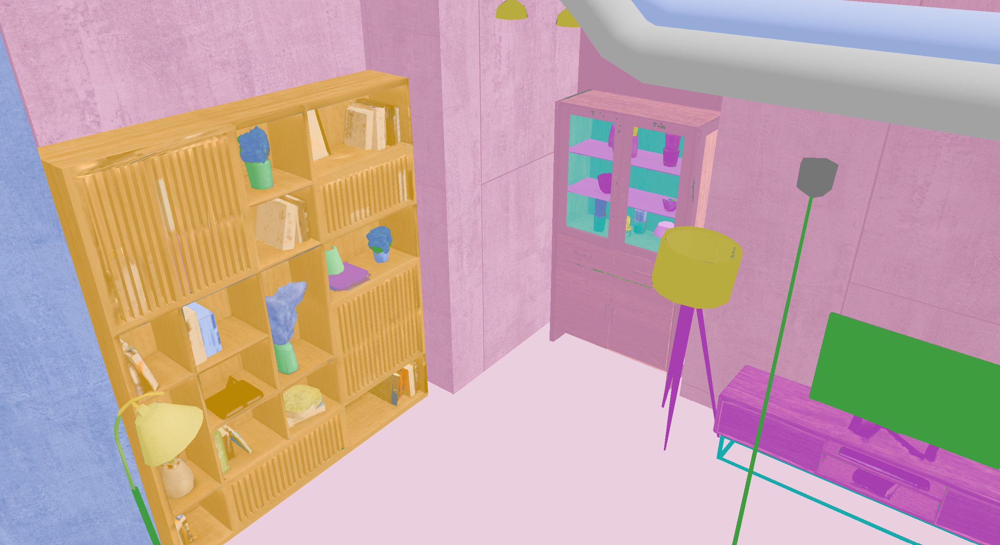

# Real-time Screen-space Object Detection using Per-pixel Fragment List

Research renderer developed for a master's thesis at the Technical University of Munich (TUM). The project investigates screen-space object segmentation using **per-pixel linked lists (PPLL)**, **union-find**, and an optional **SAM2** segmentation pipeline.

- **Author:** Sina Bolouki
- **Supervisor:** Prof. R. Westermann
- **Implementation:** C++20 and Vulkan
- **CMake project / executable:** `DepthPeelingRenderer`

## Example results

Original rendered views compared with union-find segmentation. The colors in the results mark connected regions produced by the current connectivity criteria.

### Sponza

| Original scene | Union-find segmentation |
| :---: | :---: |
|  |  |

### Room

| Original scene | Union-find segmentation |
| :---: | :---: |
|  |  |

## Overview

A conventional image retains the visible surface at each pixel. A per-pixel linked list can retain multiple fragments along the same viewing ray, including fragments behind the frontmost surface. This provides a layered screen-space representation for investigating segmentation beyond the visible image.

The project combines this fragment representation with union-find, a disjoint-set data structure used to group elements into connected components. The research goal is to obtain coherent regions from the rendered fragment information.

### Per-pixel linked lists

Each screen pixel is associated with a linked list of fragments generated during rasterization. Following the list gives access to the retained fragments at that pixel rather than only the nearest surface.

The list links describe storage and traversal. They do not, by themselves, establish that the fragments belong to the same object. Multiple objects can project onto the same pixel.

### Union-find

Union-find maintains groups through two operations:

- **`find(element)`** returns the representative of the element's current group.
- **`union(a, b)`** merges two groups when their elements satisfy the segmentation's connectivity criteria.

Elements with the same final representative belong to the same connected component. The connectivity criteria determine the segmentation; union-find efficiently maintains the resulting groups.

A connected component is a region produced by those criteria. Its correspondence to a complete physical object is part of the segmentation problem.

## Renderer selection

Select the renderer when configuring CMake using the **`THESIS_RENDERER`** setting. The default is **`UNION_FIND`**.

| Value | Purpose |
| --- | --- |
| `SIMPLE` | Basic forward renderer for testing scene rendering. |
| `DEPTH_PEELING` | Depth-peeling implementation. |
| `PPLL` | Per-pixel linked-list implementation. |
| `UNION_FIND` | PPLL with union-find grouping; the default renderer. |
| `SAM2` | Capture ordered PPLL depth layers and send their images to a separate SAM2 server for segmentation. |

Choose exactly one value, using the uppercase spelling shown above. Unsupported values cause CMake configuration to fail.

Renderer selection is a **build setting**. After changing it, configure CMake again and rebuild the application. No renderer-selection macros need to be edited in `src/application.h`.

- **Command line:** pass `-DTHESIS_RENDERER=<value>` to the CMake configure command, as shown in [Build on Windows](#build-on-windows).
- **VS Code:** set `THESIS_RENDERER` inside `cmake.configureSettings`, then use **Configure → Build**, as shown in [Build with VS Code](#build-with-vs-code).

The setting selects the renderer used by the application and its associated controls. The current CMake build still compiles all renderer source files and shaders.

### SAM2 mode

SAM2 segmentation additionally requires a separately running Python SAM2 server with its model installed. Start the server before requesting segmentation. The other renderer modes do not require a running SAM2 server.

In the application's **SAM2 Offline Pipeline** panel:

1. Set the server **Host** and **Port** under **SAM2 Server**. The defaults are `127.0.0.1` and `8765`.
2. Click **Check server** to verify the connection.
3. Click **Capture layers** to capture the current view. With **Auto-segment after capture** enabled, segmentation starts automatically; otherwise click **Segment last capture** afterward.

## Requirements

The build instructions below target **64-bit Windows with vcpkg**.

| Requirement | Details |
| --- | --- |
| C++ compiler | A C++20-capable compiler; the example uses Visual Studio 2022 with the **Desktop development with C++** workload. |
| CMake | **3.21 or newer**. |
| Git | Required to initialize the `vk-bootstrap` submodule. |
| Vulkan SDK | Must provide Vulkan headers, libraries, and `glslangValidator` for shader compilation. |
| GPU and driver | Vulkan support compatible with the renderer's runtime requirements. |
| vcpkg | Used to install the libraries listed below. |

### Dependencies

| Dependency | Purpose | How it is provided |
| --- | --- | --- |
| Vulkan | Graphics and compute API | Vulkan SDK; `find_package(Vulkan)` |
| GLFW | Window and input handling | vcpkg package `glfw3` |
| GLM | Mathematics library | vcpkg package `glm` |
| tinyobjloader | OBJ model loading | vcpkg package `tinyobjloader` |
| Dear ImGui | User interface | vcpkg package `imgui` |
| vk-bootstrap | Vulkan initialization helpers | Git submodule at `vk-bootstrap/` |

## Build on Windows

Run the following commands in **PowerShell**. Start from the repository root, where `CMakeLists.txt` is located.

### 1. Initialize the submodule

```powershell
git submodule update --init --recursive
```

This populates `vk-bootstrap/`, which CMake includes with `add_subdirectory(vk-bootstrap)`.

### 2. Install the Vulkan SDK

Install the [Vulkan SDK for Windows](https://vulkan.lunarg.com/sdk/home). The supplied VS Code settings use SDK **1.4.357.0** at `C:/VulkanSDK/1.4.357.0`. This is the local installation used in the examples below; update the paths for another installed SDK version.

Open a new terminal after installation so it receives the updated environment.

Check that the SDK and shader compiler are available:

```powershell
$env:VULKAN_SDK
glslangValidator --version
cmake --version
```

### 3. Set up vcpkg and install dependencies

The example uses `C:\vcpkg`, matching the supplied VS Code settings. Change this path to your existing vcpkg installation if needed.

```powershell
$vcpkgPath = "C:\vcpkg"
```

If vcpkg is not installed yet, clone and bootstrap it:

```powershell
git clone https://github.com/microsoft/vcpkg.git $vcpkgPath
& "$vcpkgPath\bootstrap-vcpkg.bat"
```

Install the dependencies for `x64-windows`:

```powershell
& "$vcpkgPath\vcpkg.exe" install `
    "glfw3:x64-windows" `
    "glm:x64-windows" `
    "tinyobjloader:x64-windows" `
    "imgui[glfw-binding,vulkan-binding]:x64-windows"
```

The ImGui features supply its GLFW and Vulkan backends. These commands use vcpkg's classic mode for manually installed dependencies.

### 4. Configure CMake

From the repository root, in the same PowerShell session, configure with the paths used by the VS Code settings:

```powershell
$vulkanSdkPath = "C:/VulkanSDK/1.4.357.0"

cmake -S . -B build `
    -G "Visual Studio 17 2022" -A x64 `
    "-DCMAKE_TOOLCHAIN_FILE=$vcpkgPath/scripts/buildsystems/vcpkg.cmake" `
    -DVCPKG_TARGET_TRIPLET=x64-windows `
    "-DVulkan_INCLUDE_DIR=$vulkanSdkPath/Include" `
    "-DVulkan_LIBRARY=$vulkanSdkPath/Lib/vulkan-1.lib" `
    -DTHESIS_RENDERER=UNION_FIND
```

CMake discovers the installed libraries through the vcpkg toolchain file and configures the selected renderer, shader compilation, and asset-copy targets.

The example explicitly selects `UNION_FIND`. Replace it with another value from [Renderer selection](#renderer-selection), such as `SAM2`. If the setting has never been configured in this build directory, omitting it uses the `UNION_FIND` default. Once configured, CMake retains the selected value in the build directory's cache; pass the new value when switching renderers.

The command above explicitly chooses the Visual Studio 2022 generator and a 64-bit build. The supplied VS Code settings do not choose a generator or compiler.

VS Code's `cmake.configureSettings` values are supplied by the CMake Tools extension. A standalone `cmake` command does not read `.vscode/settings.json`, so the terminal example supplies the relevant values as `-D` arguments.

The Vulkan include and library paths do not explicitly locate the shader compiler. If CMake cannot find `glslangValidator`, verify that it is installed and rerun configuration with this additional argument, adjusting the SDK path if needed:

```powershell
"-DVulkan_GLSLANG_VALIDATOR_EXECUTABLE=C:/VulkanSDK/1.4.357.0/Bin/glslangValidator.exe"
```

### 5. Build

```powershell
cmake --build build --config Release --parallel
```

The renderer target depends on `compile_shaders` and `copy_assets`, so both are included in the build.

## Build with VS Code

Install the **CMake Tools** extension and open the repository folder in VS Code. Initialize the submodule and install the dependencies as described above.

For repository-local configuration, use `.vscode/settings.json` with the supplied settings:

```json
{
  "cmake.configureSettings": {
    "CMAKE_TOOLCHAIN_FILE": "C:/vcpkg/scripts/buildsystems/vcpkg.cmake",
    "CMAKE_CXX_STANDARD": "20",
    "CMAKE_CXX_STANDARD_REQUIRED": "ON",
    "Vulkan_INCLUDE_DIR": "C:/VulkanSDK/1.4.357.0/Include",
    "Vulkan_LIBRARY": "C:/VulkanSDK/1.4.357.0/Lib/vulkan-1.lib",
    "THESIS_RENDERER": "UNION_FIND"
  }
}
```

Update the vcpkg and Vulkan SDK paths for the local machine. The C++20 settings repeat values already set in `CMakeLists.txt`.

For CMake Tools' kit-based workflow, use the Command Palette:

1. **CMake: Select a Kit** — select an installed compiler targeting 64-bit Windows.
2. **CMake: Select Variant** — choose `Release` for performance measurements or `Debug` for debugging.
3. **CMake: Configure** — configure the project with the selected compiler, renderer, and settings.
4. **CMake: Build** — build the renderer, shaders, and copied assets.

To switch renderers, change only the `THESIS_RENDERER` value in `.vscode/settings.json`. For example:

```json
"THESIS_RENDERER": "SAM2"
```

Save the file, run **CMake: Configure**, and then run **CMake: Build**. The normal VS Code Configure and Build buttons can be used for these steps. Reconfiguration applies the renderer setting, and rebuilding updates the executable; a normal renderer switch does not require deleting the CMake cache.

The supplied settings do not specify a generator, build directory, or launch working directory. CMake Tools' default build directory is `${workspaceFolder}/build`, but other settings or presets can select another directory. Check the CMake output for the actual generator and build location.

## Run

For the Visual Studio command-line build above, launch the application with **`build/` as the working directory**, where the generated shaders and copied assets are located:

```powershell
Push-Location .\build
.\Release\DepthPeelingRenderer.exe --scene "assets/sponza/sponza.obj"
Pop-Location
```

For a Debug build, run these commands from the repository root:

```powershell
cmake --build build --config Debug --parallel
Push-Location .\build
.\Debug\DepthPeelingRenderer.exe --scene "assets/sponza/sponza.obj"
Pop-Location
```

When launching through an IDE, set the working directory to the actual CMake build directory, which contains `shaders/` and `assets/`. The configure settings above do not set the launch working directory; the VS Code example below adds it for debugging. Use a Release build for performance measurements.

The `Release/` and `Debug/` executable directories above are specific to the Visual Studio generator. Single-configuration generators such as Ninja normally place the executable directly in the build directory.

### Choose a scene

The repository includes the Sponza OBJ and its supporting files under `assets/sponza/`. CMake copies them into `build/assets/sponza/`; the launch commands above select this bundled scene with `--scene`.

Select another OBJ file at startup with `--scene`. Changing scenes does not require reconfiguring CMake or rebuilding the executable.

```powershell
Push-Location .\build
.\Release\DepthPeelingRenderer.exe --scene "C:/Scenes/room/model.obj"
Pop-Location
```

Absolute paths can point to scenes outside the repository. Relative paths are resolved from the **working directory**, so `--scene "assets/office/model.obj"` refers to `build/assets/office/model.obj` when running from `build/`. Keep the referenced `.mtl` and texture files available beside the OBJ, including any relative subdirectories used by the material files. The existing scene loader resolves those files from the OBJ's directory.

Without `--scene`, the application currently uses `assets/simple_room/simple_room.obj`. This OBJ is not tracked in the repository. Pass `--scene "assets/sponza/sponza.obj"` to use the bundled scene, or supply a path to another local OBJ.

The application checks that the selected file exists before creating the window or initializing Vulkan, and reports its absolute path if the check fails. To see the available startup options:

```powershell
.\build\Release\DepthPeelingRenderer.exe --help
```

### Scene arguments in VS Code

For **CMake: Debug**, add `cmake.debugConfig` alongside your existing `cmake.configureSettings` in `.vscode/settings.json`:

```json
"cmake.debugConfig": {
  "cwd": "${workspaceFolder}/build",
  "args": ["--scene", "assets/sponza/sponza.obj"]
}
```

This example selects the bundled Sponza scene. Replace the OBJ path to select another scene, and adjust `cwd` if your CMake build directory is elsewhere. Use the build directory containing `shaders/`, including for Visual Studio builds whose executable is inside `Debug/` or `Release/`. Run **CMake: Debug** after building. To switch scenes later, edit only the path in `args` and restart the application.

## Repository and build layout

| Path | Contents |
| --- | --- |
| `CMakeLists.txt` | Project configuration, renderer selection, library discovery, shader compilation, and asset copying. |
| `.vscode/settings.json` | Repository-local VS Code CMake Tools configuration, when the supplied settings are placed here. |
| `src/` | C++ source and header files collected recursively by CMake. |
| `shaders/` | GLSL vertex, fragment, and compute shaders. |
| `assets/` | Runtime assets copied into the build directory. |
| `external/` | Additional include directory available to the renderer. |
| `vk-bootstrap/` | Vulkan initialization library supplied as a Git submodule. |
| `build/Release/DepthPeelingRenderer.exe` | Release executable with the Visual Studio generator. |
| `build/shaders/` | Compiled SPIR-V shaders, preserving the source subdirectories. |
| `build/assets/` | Copy of the source asset directory. |

### Shader compilation

CMake searches `shaders/` recursively for `.vert`, `.frag`, and `.comp` files and compiles them with `glslangValidator -V`. Each output preserves its source-relative path and appends `.spv`.

For example, a shader at `shaders/example.comp` would produce `build/shaders/example.comp.spv`.

The outputs are under **`build/shaders/`**; the current commands do not create a `compiled_shaders/` directory or compile shaders from `assets/`.

After editing an existing shader, rebuild normally. After adding a new shader or C++ source file, rerun the CMake configure command before building, because the file lists are collected during configuration.

## Troubleshooting

| Problem | Check |
| --- | --- |
| CMake cannot find GLFW, GLM, tinyobjloader, or ImGui | Confirm the packages are installed for `x64-windows` and the configure command includes the correct vcpkg toolchain path. |
| `vk-bootstrap` is missing or has no `CMakeLists.txt` | Run `git submodule update --init --recursive` from the repository root. |
| Vulkan or `Vulkan::glslangValidator` cannot be found | Verify the Vulkan SDK installation, use CMake 3.21 or newer, and configure again from a terminal with the SDK environment available. |
| The Vulkan SDK was upgraded or moved | Update `Vulkan_INCLUDE_DIR` and `Vulkan_LIBRARY` in the VS Code settings or terminal configure arguments; check the shader compiler path as well. |
| GLFW or Vulkan ImGui backend symbols are unresolved | Confirm ImGui was installed with the `glfw-binding` and `vulkan-binding` features. |
| The application reports that the scene file is missing or not a regular file | Pass `--scene "path/to/scene.obj"`. Relative paths start at the launch working directory; use an absolute path to remove ambiguity. The default OBJ is not tracked in the repository. |
| The application cannot locate shaders or assets | Set the working directory to `build/` and confirm the build completed its shader and asset targets. |
| CMake reports a generator or toolchain mismatch | Configure into a new build directory when changing generators, compilers, or dependency triplets. |
| A newly added source or shader is not built | Rerun CMake configuration so its recursive file searches include the new file. |
| CMake rejects the renderer value | Use exactly one of `SIMPLE`, `DEPTH_PEELING`, `PPLL`, `UNION_FIND`, or `SAM2` for `THESIS_RENDERER`. |
| The application still uses the previous renderer | Save the new `THESIS_RENDERER` value, configure CMake again, and rebuild the executable you are launching. In VS Code, use **CMake: Configure**, then **CMake: Build**. |
| SAM2 reports that the server is not reachable | Start the separate SAM2 server, check its host and port against the **SAM2 Server** panel, and click **Check server**. |

## Research considerations

- The fragment representation depends on the camera view and the geometry rasterized into the image.
- PPLL memory use grows with the number of retained fragments; overlapping geometry can increase storage requirements substantially.
- Union-find groups follow the chosen connectivity criteria, which can split one object into several regions or merge separate objects.

## Build references

- [VS Code CMake Tools settings](https://github.com/microsoft/vscode-cmake-tools/blob/main/docs/cmake-settings.md)
- [vcpkg integration with CMake](https://learn.microsoft.com/en-us/vcpkg/users/buildsystems/cmake-integration)
- [ImGui package and backend features in vcpkg](https://vcpkg.io/en/package/imgui.html)
- [CMake FindVulkan documentation](https://cmake.org/cmake/help/latest/module/FindVulkan.html)
- [vk-bootstrap](https://github.com/charles-lunarg/vk-bootstrap)
